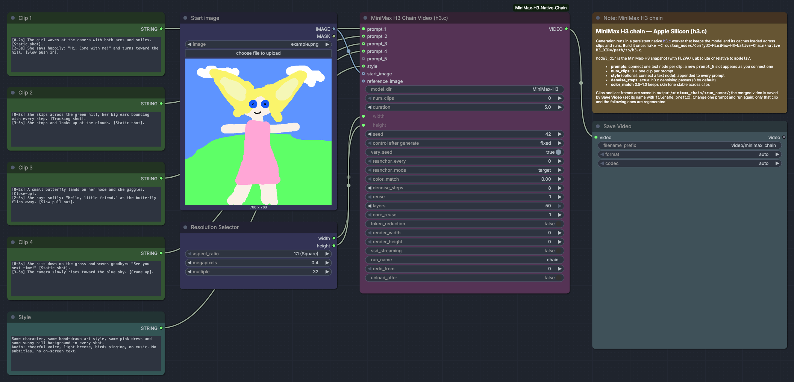

# ComfyUI MiniMax H3 Native Chain (Apple Silicon, h3.c)

A ComfyUI node for Apple Silicon Macs that chains [MiniMax H3](https://www.minimax.io/blog/minimax-h3) clips into one long video, generated by the native Metal engine [h3.c](https://github.com/antirez/h3.c):

```
start image (optional) → clip 1 → last frame → clip 2 → last frame → … → clip N → merged video
```

You write one prompt per clip. The node generates the clips one after another, each starting from the last frame of the previous clip. Without a start image, clip 1 is generated from text only (text-to-video). It saves every clip and every last frame, and returns the merged video with audio.



## How it works

```
ComfyUI node (h3_chain_node.py)  ──JSON lines over stdin/stdout──▶  h3_comfy_worker (native, one process)
  prompts, anchors, cache,                                         h3_load_dir() once, cache enabled
  color match, montage, UI                                         h3_generate() per clip → clip MP4 + last-frame PNG
```

- The worker keeps one `h3_ctx` alive across all clips and across runs, so h3.c reuses what it considers reusable (video decoder, prepared DiT, prompt conditioning). It writes each clip's MP4 (H.264 + AAC) itself and saves the final decoded frame as `clip_NNN_last.png` straight from h3.c's frame callback; that PNG is the next clip's first-frame anchor, so no MP4 is ever decoded to chain clips.
- The worker is a separate process: a native crash fails the node, not ComfyUI. A dead worker is restarted on the next run; it exits with ComfyUI.
- h3.c progress callbacks drive the progress display; Cancel in ComfyUI stops h3.c through the same callbacks.

## Requirements

- An Apple Silicon Mac. Memory needs are h3.c's: see its README (`ssd_streaming` trades speed for much less memory).
- FFmpeg and FFprobe on `PATH` (`brew install ffmpeg`), or set `H3_FFMPEG` / `H3_FFPROBE`.
- A local checkout of [h3.c](https://github.com/antirez/h3.c). Nothing is downloaded or built automatically.
- The official MiniMax-H3 checkpoint, by default in `ComfyUI/models/MiniMax-H3/`. Accept the [MiniMax-H3 license](https://huggingface.co/MiniMaxAI/MiniMax-H3) first, then from the ComfyUI folder:

```bash
hf download MiniMaxAI/MiniMax-H3 --include "FL2VA/*" --local-dir models/MiniMax-H3
```

h3.c needs `FL2VA/transformer`, `FL2VA/tokenizer`, `FL2VA/text_encoder`, `FL2VA/video_vae/source` and `FL2VA/audio_vae`; the worker reports exactly what is missing. The optional `voice` input also needs the Ref2VA checkpoint: `hf download MiniMaxAI/MiniMax-H3 --include "Ref2VA/*" --local-dir models/MiniMax-H3`. A running worker only sees `Ref2VA/` after a restart (`unload_after`, or restart ComfyUI).

## Installation

```bash
cd ComfyUI/custom_nodes
git clone https://github.com/flaviodelgrosso/ComfyUI-MiniMax-H3-Native-Chain.git
git clone https://github.com/antirez/h3.c.git ~/h3.c
make -C ComfyUI-MiniMax-H3-Native-Chain/native H3_DIR=~/h3.c
```

`make` builds `libh3.a` in the h3.c checkout with h3.c's own Makefile, then links `native/h3_comfy_worker` against it. The worker remembers the checkout path (h3.c compiles `h3_shaders.metal` from it at runtime), so keep the checkout where it is, and rerun the same `make` after updating h3.c. Paths containing spaces are not supported by the Makefile.

Restart ComfyUI. The node appears as **MiniMax H3 Chain Video (h3.c)** in the `video/minimax` category.

## Quick start

1. Open `example_workflows/minimax_h3_chain.json`: drag it onto the canvas, or find it under **Templates** in the custom node examples.
2. Pick a start image in **Start image** (or remove it for text-to-video) and the size in **Resolution Selector**.
3. Write one prompt per clip in the **Clip N** text nodes. To add a clip, connect another text node to the next free `prompt_N` slot.
4. Press **Run**.

The `VIDEO` output is the merged video. Connect a Save Video node to preview and save it; its `filename_prefix` sets the file name.

Generated clips are cached in `ComfyUI/output/h3_cache/`, each named after the hash of everything that determines it, so any run or workflow with the same inputs reuses them:

```
<hash>.mp4         the clip
<hash>_last.png    its last frame, the start frame of the next clip
<hash>.json        prompt, seed, frame count, time and per-phase h3 timings
<hash>_first.png   color-matched start frame (with color_match)
<image hash>.png   start and reference images
```

The folder only grows: delete it, or old files in it, to free space.

ComfyUI's progress bar counts denoising steps over the whole chain: with 2 clips of 8 `denoise_steps`, each step is 1/16 of the bar; cached clips count as done. The ComfyUI console shows a live bar for the running h3.c phase (text encoder layers, denoising steps, VAE layers…), refreshed every second, and logs one line per finished phase with its time, then the clip and run totals.

## Inputs

| Input | Description |
| --- | --- |
| `model_dir` | MiniMax-H3 snapshot folder containing `FL2VA/`, absolute (`~` allowed) or relative to ComfyUI's `models/` folder |
| `prompts` | `prompt_1`, `prompt_2`, …: one input per clip, in order. Connect a Text (Multiline) node to each; a new slot appears as you connect one |
| `style` | Optional input: connect a Text (Multiline) node; its text is appended to every prompt (look, camera, audio) |
| `num_clips` | Number of clips; `0` = one clip per prompt. Fewer prompts than clips repeats the last prompt; extra prompts are ignored. A warning is logged in both cases |
| `duration` | Seconds per clip, snapped up by h3.c to the model's 17k+5 frame grid at 24 fps (5 s = 124 frames) |
| `width`, `height` | Output canvas, multiples of 32, at most 768×1344 pixels. 512–768 px squares are h3.c's validated sizes |
| `seed`, `vary_seed` | Base seed; with `vary_seed` each clip uses `seed + clip index` |
| `start_image` | Optional first frame of clip 1. Leave empty to generate clip 1 from text only |
| `voice` | Optional voice sample (`AUDIO`, at least 2 s; only the first 15 s are used) for the speech of every clip, see below |
| `reanchor_every`, `reanchor_mode`, `reference_image` | Anti-drift, see below |
| `color_match` | `0`–`1`: before each chained clip, match the hue and saturation of its start frame to the reference image (Lab a/b channels; brightness and contrast are not changed). `0` = off |
| `denoise_steps` | Actual h3.c denoising passes per clip (`h3 --steps`, default `8`): 8 means 8 model passes |
| `redo_from` | Regenerate from this clip onwards even if cached; `0` = off |

Advanced inputs (h3.c accelerations, all off by default because they are approximations; h3.c validates combinations and reports invalid ones):

| Input | h3.c | Description |
| --- | --- | --- |
| `reuse` | `--reuse` | Evaluate the denoiser on one of every N steps: 1 exact, 2 fast, 3 aggressive. Cannot be combined with `core_reuse > 1` |
| `layers` | `--layers` | DiT blocks kept: 50 exact, 45 fast, 40 aggressive |
| `core_reuse` | core reuse | Recompute the transformer core every N steps: 1 exact, 4 fast, 6 aggressive |
| `token_reduction` | token reduction | Pair adjacent video tokens in middle blocks (aggressive) |
| `render_width`, `render_height` | `--render-width/height` | Lower internal canvas, upscaled to the output size. Both `0` (native) or both set, same aspect ratio |
| `ssd_streaming` | `--ssd-streaming` | Keep only two BF16 DiT blocks resident and stream the rest: much less memory, slower. Same output, so not part of the cache key |
| `unload_after` | | Stop the worker after the run to free its memory. Off keeps the model and h3.c caches warm for the next run |

## Fixing a clip

Edit that clip's prompt node, or change the seed, and run again. Earlier clips come from the cache. The edited clip is regenerated, and so are the clips after it, because they start from its new last frame.

The cache is keyed on prompt, seed, size, duration, denoising steps, the h3.c quality settings above (except `ssd_streaming`), the color-match strength and the input frames. It does **not** track the model files or the h3.c version. After changing them, set `redo_from` to `1` for one run (then back to `0`), or delete `output/h3_cache/`.

A failed or cancelled clip is written under a `.partial` name and deleted; the clips before it stay cached.

## Anti-drift

Over many clips, faces and details slowly drift. With `reanchor_every = K`:

- **`target`** (default): clips K, 2K, … are generated with the previous last frame as first frame and the reference image as last frame (h3.c `first_frame` + `last_frame`). The chain returns smoothly to the reference with no cut.
- **`replace`**: clips K+1, 2K+1, … start from the reference image instead of the previous last frame. This gives a hard cut, so those clips keep their first frame in the merge.

`reference_image` defaults to `start_image`, or to the last frame of clip 1 when there is no start image.

Each clip starts from a generated, VAE-decoded frame, so colors, contrast and skin texture degrade a little at every hop. `color_match` (try `0.5`–`1.0`) and `reanchor_every = 2` with `target` counter this.

## Voice

Connect a Load Audio node to `voice` to make the person speak with that voice. h3.c only takes reference audio through its Ref2VA checkpoint, which has no first/last-frame anchors, so every clip is generated with its start frame as `<Picture 1>` and the voice as `<Audio 1>` (h3.c `--ref-image` + `--ref-audio`):

- Name the references in the prompts, e.g. in `style`: `The person in <Picture 1> speaks with the voice from <Audio 1>.`
- The start frame is a reference, not frame 0, so seams are soft cuts and no frame is dropped in the merge.
- Clip 1 needs an image: `start_image`, or `reference_image` without a start image.
- h3.c accepts at most 15 s of reference audio: a longer sample is cut to its first 15 s, with a warning in the log. Pick a clean single-speaker sample.
- There is no last-frame anchor, so `reanchor_mode` `target` behaves like `replace`.

## Merge

Clip 1 is kept whole. Every following clip, except `replace` re-anchored ones, drops its first frame and the matching 1/24 s of audio, because that frame duplicates the previous clip's last frame. The clips are concatenated by ComfyUI's video API into the `VIDEO` output at 24 fps with the generated audio.

## Tips

- Use a sharp start image. End each clip on a calm, front-facing moment, because that frame starts the next clip.
- Describe the character, outfit, background and lighting the same way in every clip; the `style` input does this for you.
- Only the frame carries over, not motion or sound. Keep camera moves consistent between neighbouring prompts, and don't split a sentence of dialogue across two clips.
- Iterate fast at a low resolution or with `render_width`/`render_height`, then switch to the final size. Changing size, duration, steps or h3.c settings regenerates all clips.
- h3.c's diagnostics (cache hits, warnings) appear in the ComfyUI log prefixed with `[h3]`.

## Worker protocol

`native/h3_comfy_worker` reads one JSON object per line on stdin and writes one JSON event per line on stdout; diagnostics go to stderr. `SIGUSR1` cancels the running generation.

```json
{"command":"load","model_dir":"/path/to/MiniMax-H3"}
{"command":"generate","prompt":"…","width":640,"height":640,"frames":124,"steps":8,"seed":42,
 "first_frame":"/run/clip_001_last.png","last_frame":null,"ref_image":null,"ref_audio":null,"output":"/run/clip_002.partial.mp4",
 "last_frame_output":"/run/clip_002_last.partial.png","reuse":1,"layers":50,"core_reuse":1,
 "token_reduction":false,"render_width":0,"render_height":0,"ssd_streaming":false}
```

`ref_image` and `ref_audio` are passed to h3.c as Ref2VA references, in that order, and cannot be combined with `first_frame`/`last_frame`.

Events: `ready`, `loaded`, `progress` (`phase`, `completed`, `total`; the worker adds `video VAE decode` and `last frame`, which h3.c does not report itself), `complete` (output paths, frames, seconds, per-phase `timings`, h3 cache state, peak memory footprint) and `error` (h3.c's `h3_last_error()` message, `cancelled`).
